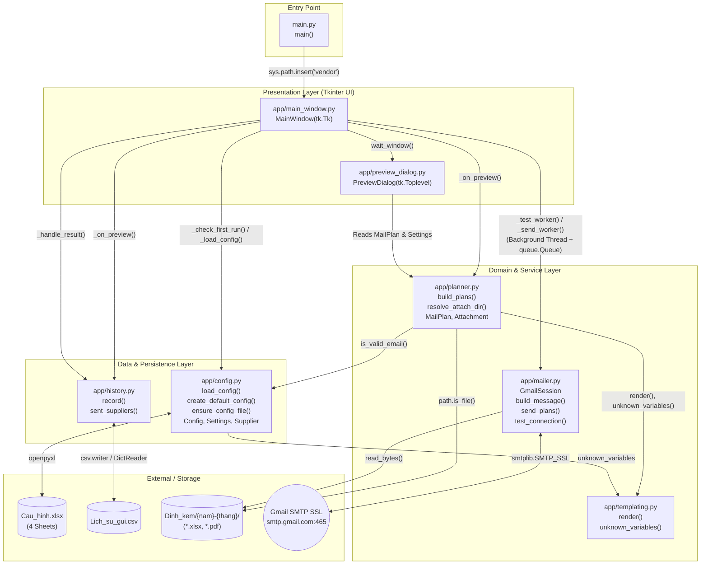
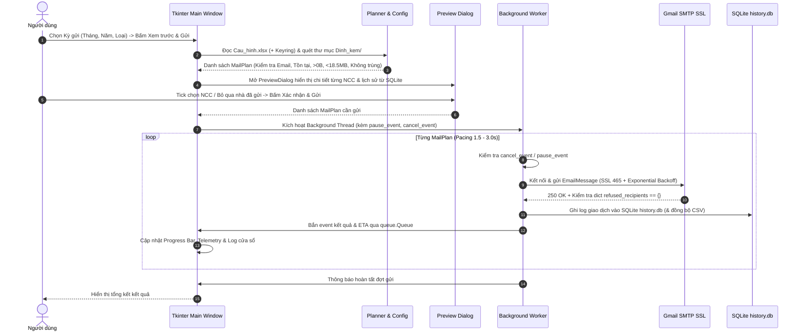

# Architecture, Code Call Graph & Data Flow

## 1. Sơ Đồ Kiến Trúc & Phụ Thuộc Mô-đun Hiện Tại (Current Codebase Call Graph)

---

## 2. Clean Architecture Layers (Kiến Trúc Mục Tiêu v1.1.0 & v1.2.0)

- **Domain Layer**: `MailPlan`, `Attachment`, `Settings`, `Supplier`, `SendResult` (Dataclasses thuần túy, bất biến, độc lập 100% khỏi framework I/O hay GUI).
- **Service Layer**:
  - `planner.py`: Tính toán kế hoạch gửi, kiểm tra tồn tại file, kiểm tra file rỗng `0 byte`, kiểm tra giới hạn dung lượng `< 18.5MB` (trước Base64), phát hiện trùng mã NCC và ký tự đường dẫn bất hợp pháp.
  - `templating.py`: Xử lý nội suy biến an toàn, phát hiện biến lạ.
  - `mailer.py`: Quản lý phiên kết nối `GmailSession`, kiểm tra từ điển địa chỉ bị từ chối trả về từ `send_message()` (chống lỗi Silent Partial Delivery), thực thi **Smart Pacing (1.5 - 3.0s)**, **Exponential Backoff Retry**, và lắng nghe cờ `pause_event` / `cancel_event`.
  - `updater.py`: Kiểm tra phiên bản mới qua GitHub Releases API, tải gói cập nhật với xác thực mã băm SHA-256 và bàn giao cho tiến trình `updater.exe`.
- **Adapter Layer**:
  - `config.py`: Adapter đọc/ghi file Excel thông qua `openpyxl` (đảm bảo đóng `wb.close()`, bắt lỗi file hỏng `BadZipFile`, tự động migrate cấu trúc sheet khi cập nhật OTA).
  - `security.py`: Adapter lưu trữ Mật khẩu ứng dụng Gmail qua **Windows Credential Manager (`keyring`)** / mã hóa AES-256-GCM và xóa plaintext trong Excel.
  - `history.py`: Adapter lưu trữ lịch sử qua **SQLite (`history.db`)** nguyên tử và tự động xuất CSV/Excel chống lỗi Excel cắt số `0` ở cột Tháng và chống CSV Injection.
- **Presentation Layer**:
  - `main_window.py`: Cửa sổ Tkinter bật High-DPI Awareness, điều khiển luồng nền (Pause / Resume / Cancel), bắt sự kiện đóng cửa sổ an toàn (`WM_DELETE_WINDOW`) và nhận telemetry qua `queue.Queue`.
  - `preview_dialog.py`: Hộp thoại xem trước hỗ trợ chọn/bỏ chọn nhanh từng nhà cung cấp trước khi gửi.

---

## 3. Luồng Dữ Liệu Chi Tiết (Data Flow)

