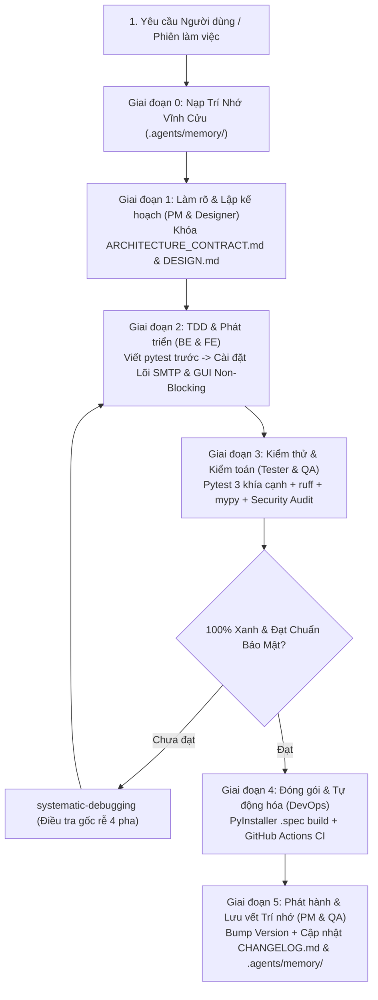

# Chu Trình Kỹ Nghệ Đa Tác Nhân (Antigravity Team Workflow)

Dự án **Ứng dụng Gửi Email Hàng Loạt Cho Nhà Cung Cấp (Gmail Auto Mailer)** được vận hành bởi **7 Sub-Agents chuyên trách** theo chu trình kỹ nghệ khép kín 6 giai đoạn nghiêm ngặt, có bộ nhớ vĩnh cửu và kiểm toán an toàn tuyệt đối.

---

## ⚡ Sơ Đồ Chu Trình 6 Giai Đoạn

---

## 📋 Chi Tiết 6 Giai Đoạn Vận Hành

### Giai đoạn 0: Nạp Trí Nhớ Vĩnh Cửu (`agent-memory`)
- **Tác nhân**: Tất cả Sub-Agents.
- **Hành động bắt buộc**:
  - Đọc file `.agents/memory/user_profile.md` để nắm bắt bối cảnh người dùng, môi trường vận hành (Windows, Office/Excel, Gmail).
  - Đọc `.agents/memory/active_sprint.md` để kiểm tra tiến độ hiện tại, backlog và các đầu việc dở dang.
  - Đọc `.agents/memory/technical_decisions.md` để tôn trọng các quyết định kiến trúc đã cam kết (Hybrid Password, SQLite History, Tkinter Modern Enterprise, Pacing 1.5-3s).
  - Triệt tiêu 100% hiện tượng "quên ngữ cảnh" giữa các phiên chat.

### Giai đoạn 1: Làm rõ & Lập kế hoạch (`Plan & Contract`)
- **Chủ trì**: `pm-agent`, phối hợp `designer-agent` và `qa-agent`.
- **Hành động bắt buộc**:
  - Sử dụng kỹ năng `brainstorming` và `grill-me` làm rõ các góc khuất kỹ thuật trước khi code.
  - Cập nhật hợp đồng kiến trúc `docs/ARCHITECTURE_CONTRACT.md` (định dạng dữ liệu cấu hình, sự kiện Background Worker, schema SQLite).
  - Khóa hệ thống thiết kế `DESIGN.md` (Modern Enterprise Clean palette, bố cục, phân tầng trực quan, chống AI slop).
  - Phân rã công việc thành các micro-tasks (2–5 phút mỗi task) kèm tiêu chí nghiệm thu rõ ràng.

### Giai đoạn 2: Phát triển Theo Chuẩn Kiểm Thử (`TDD & Implementation`)
- **Chủ trì**: `be-agent` (Lõi SMTP, Pacing, SQLite, Bảo mật) & `fe-agent` (Tkinter Modern GUI, Non-Blocking Worker).
- **Hành động bắt buộc**:
  - Thực thi theo tôn chỉ **Test-Driven Development (TDD)**: Viết bài test `pytest` trước khi viết code logic.
  - Lõi Backend tuân thủ Python Clean Architecture (`domain -> adapters -> services`), tuyệt đối không dính líu đến widget GUI.
  - Giao diện Tkinter chạy trên Main Thread, mọi tác vụ I/O đĩa và mạng (đọc Excel, kết nối Gmail, gửi SMTP) chạy 100% trên Background Worker (`threading.Thread` + `queue.Queue`).
  - Hỗ trợ đầy đủ bộ điều khiển: Bắt đầu, Tạm dừng (Pause), Tiếp tục (Resume), Hủy (Cancel) tức thì.

### Giai đoạn 3: Kiểm Thử & Kiểm Toán Chất Lượng (`Tester & QA Gatekeeper`)
- **Chủ trì**: `tester-agent` & `qa-agent`.
- **Hành động bắt buộc**:
  - `tester-agent` chạy bộ kiểm thử toàn diện **3 khía cạnh**:
    1. *Happy Path*: Đọc cấu hình chuẩn, dựng đúng 2 chế độ Tạm tính (chỉ Excel) và Chốt (Excel + PDF), gửi SMTP SSL mock thành công, lưu SQLite và CSV.
    2. *Edge Cases*: Tên tiếng Việt có dấu, file rỗng 0 byte, file siêu lớn, đường dẫn Windows dài, danh sách email hỗn hợp.
    3. *Chaos & Negative Cases*: Mất mạng đột ngột giữa chừng, Gmail sai App Password, file Excel đang bị mở khóa độc quyền bởi ứng dụng khác, nhấn Cancel dừng giữa chừng.
  - `qa-agent` kiểm toán tĩnh:
    - Chạy `ruff check` và `ruff format --check`.
    - Chạy `mypy` kiểm tra nghiêm ngặt Type Hints.
    - Kiểm toán bảo mật **Zero Plaintext Secrets**: Không commit mật khẩu, tự động lưu Windows Credential Manager (`keyring`) hoặc AES-256-GCM.
    - Cổng Release Gatekeeper: Chỉ ký duyệt khi 100% xanh.

### Giai đoạn 4: Đóng Gói & Tự Động Hóa (`Packaging & CI`)
- **Chủ trì**: `devops-agent`.
- **Hành động bắt buộc**:
  - Quản trị cấu hình qua `pyproject.toml`.
  - Đóng gói file `.exe` bằng `Gui_mail_nha_cung_cap.spec` (PyInstaller) sạch sẽ, nhúng metadata phiên bản, icon chuyên nghiệp.
  - Tự động hóa kiểm thử qua GitHub Actions CI (`.github/workflows/ci.yml`).

### Giai đoạn 5: Phát Hành & Lưu Vết Trí Nhớ (`Release & Memory Persist`)
- **Chủ trì**: `pm-agent` & `qa-agent`.
- **Hành động bắt buộc**:
  - Đồng bộ số hiệu phiên bản Semantic Versioning (`app/__init__.py`, `README.md`, `pyproject.toml`).
  - Ghi nhật ký phát hành vào `CHANGELOG.md`.
  - Cập nhật tiến độ hoàn thành sprint và cập nhật `active_sprint.md`, `technical_decisions.md` trong `.agents/memory/`.
