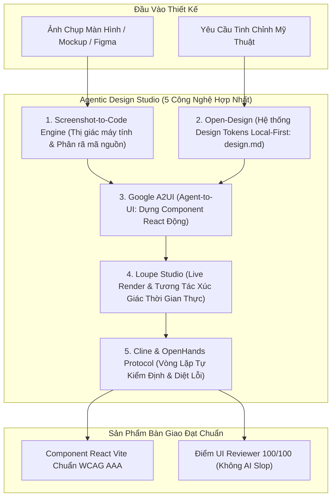

# Agentic Design Studio: Tích Hợp 5 Công Nghệ AI Thiết Kế & Lập Trình Giao Diện Mã Nguồn Mở

Tài liệu hướng dẫn và quy chuẩn hành động dành riêng cho **`designer-agent`** và **`fe-agent`**, kết hợp 5 đột phá công nghệ mã nguồn mở hàng đầu thế giới:

---

## 1. Trụ Cột 1: Screenshot-to-Code Engine (Chuyển Đổi Ảnh Thành Mã Nguồn)

Khi người dùng gửi ảnh chụp màn hình, bản vẽ hoặc thiết kế mẫu, `designer-agent` kích hoạt quy trình 4 bước chuyển dịch thị giác:

1. **Bước 1 - Phân tích Cấu trúc Lưới (Semantic Spatial Decomposition)**:
   - Xác định layout vĩ mô: Header, Hero, Grid 2/3/4 cột, Flexbox căn lề, điểm ngắt responsive (375px mobile, 768px tablet, 1280px desktop).
2. **Bước 2 - Bóc tách Màu sắc & Tương phản (Chromatic & Contrast Extraction)**:
   - Trích xuất mã màu HEX chính xác của từng bề mặt (surfaces), đường viền (borders) và văn bản (typography).
   - Kiểm tra ngay tỷ lệ tương phản W3C: Chữ chính trên nền đạt >= **7:1** (AAA).
3. **Bước 3 - Phân tách Lớp Ảnh & Lớp Chữ (Separation of Canvas & Text Layers)**:
   - **Quy tắc bất biến**: Tuyệt đối không để chữ bị vẽ cứng vào ảnh nền. Ảnh nền chỉ giữ vai trò mỹ thuật (non nước, rùa đá, đầm sen, từ đường); toàn bộ chữ phải là văn bản HTML động từ CSDL.
4. **Bước 4 - Sinh mã React + Tailwind CSS Tinh Giản**:
   - Xuất mã nguồn sạch sẽ, không hardcode kích thước pixel cố định gây vỡ màn hình điện thoại.

---

## 2. Trụ Cột 2: Open-Design (Hệ Thống Token Local-First)

Lấy cảm hứng từ kiến trúc Local-First và BYOK (Bring Your Own Key) của Open-Design:
- Toàn bộ quyết định thiết kế được lưu trữ bền vững tại file `design.md` và mã hóa thành CSS Variables / Tailwind theme.
- Không phụ thuộc vào nền tảng đám mây đóng; người dùng và Agent cùng chia sẻ và kiểm soát 100% token màu sắc, typography và spacing.
- Đảm bảo tính nhất quán trên toàn bộ 15 trang và modal của hệ thống.

---

## 3. Trụ Cột 3: Google A2UI (Agent-to-UI Dynamic Component Architecture)

Khung mã nguồn mở A2UI của Google cho phép Agent tự động sinh và điều khiển các giao diện người dùng động:
- **Component hướng dữ liệu (Data-Driven Components)**: Mọi thẻ giao diện (như `ImperialClanHero`, `GenealogyTree`, `MemorialCountdownWidget`) đều nhận props từ API thật thay vì dữ liệu giả.
- **Trạng thái trọn vẹn (Full State Coverage)**: Luôn xử lý đủ 4 trạng thái:
  1. *Loading*: Hiệu ứng Skeleton loader mềm mại.
  2. *Success*: Dữ liệu hiển thị rực rỡ, sắc nét.
  3. *Error Inline*: Báo lỗi trực quan kèm hướng dẫn khắc phục.
  4. *Empty State*: Trạng thái chưa có dữ liệu ấm cúng, tôn nghiêm.

---

## 4. Trụ Cột 4: Loupe Studio (Live Render & Tương Tác Xúc Giác)

Áp dụng phương pháp của Loupe Web Studio kết hợp triết lý Design Engineer của Emil Kowalski:
- Xem trước trực tiếp giao diện (Live Render) trên máy chủ Node.js cục bộ (`http://127.0.0.1:5000`).
- **Tactile Micro-interactions**:
  - Đổ bóng đa tầng tự nhiên (Layered Shadows) tạo chiều sâu êm ái thay vì bóng bệt một lớp.
  - Viền vi mô (Inner Highlights) `border border-amber-400/40` tạo cảm giác chạm như sơn mài và đồng thau thật.
  - Phản hồi vật lý lò xo (Spring Physics): `active:scale-95 transition-all duration-200 ease-out`.

---

## 5. Trụ Cột 5: Cline & OpenHands Protocol (Vòng Lặp Tự Kiểm Định)

Quy trình tự động đóng vai trò là một "Quality Gatekeeper" khắt khe trước khi bàn giao bất kỳ mã nguồn nào cho người dùng:
1. **Quét mã tự động với `ui-reviewer-mcp`**:
   - `node tools/mcp/ui-reviewer-mcp.mjs --audit`
   - Bắt buộc đạt **100/100 (Hạng A+)**.
   - Bắt buộc **0 vi phạm AI Slop** (không gradient tím sáo rỗng, không viền neon lố, không bo tròn con nhộng bừa bãi).
2. **Kiểm tra tương thích người cao niên**:
   - Vùng chạm ngón tay tối thiểu **44px x 44px** (ưu tiên **48px - 64px**).
   - Cỡ chữ ô nhập liệu mobile tối thiểu **16px** (chống Safari tự zoom méo trang).
3. **Biên dịch & Kiểm thử đơn vị**:
   - Chạy `npm run build` hoặc lệnh build Vite thành công.
   - Chạy bộ kiểm thử backend (`node --test server/tests/suite.cjs`) đạt 100% Passed.
