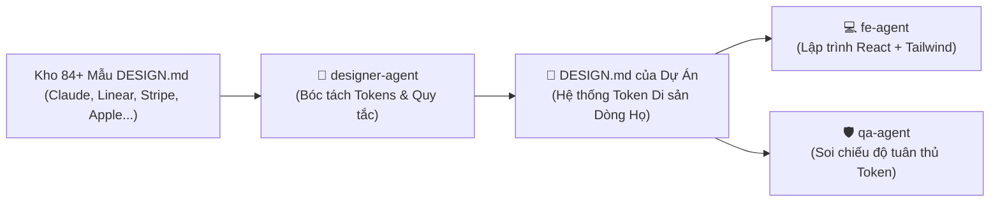

# Awesome DESIGN.md Skill (Chuẩn Mực Đặc Tả Thiết Kế Cho AI Coding Agents)

Khung kỹ nghệ **`DESIGN.md`** (được khởi xướng bởi Google Stitch và chuẩn hóa bởi VoltAgent) là định dạng đặc tả hệ thống thiết kế bằng **Markdown thuần túy** dành riêng cho các AI Coding & Design Agents.

Thay vì dựa vào các file Figma nặng nề hay schema JSON phức tạp mà AI khó phân tích, một file `DESIGN.md` cung cấp toàn bộ ngôn ngữ thiết kế (màu sắc, tỷ lệ chữ, khoảng cách, bo góc, hiệu ứng đổ bóng, và mẫu component) dưới dạng văn bản có cấu trúc cao mà LLM hiểu và áp dụng chính xác 100%.

```
┌──────────────┐      ┌─────────────────┐      ┌─────────────────────────┐
│  AGENTS.md   │ ───> │  Coding Agents  │ ───> │  Quy tắc & Quy trình    │
└──────────────┘      └─────────────────┘      └─────────────────────────┘
┌──────────────┐      ┌─────────────────┐      ┌─────────────────────────┐
│  DESIGN.md   │ ───> │  Design Agents  │ ───> │  Thẩm mỹ & Giao diện UI │
└──────────────┘      └─────────────────┘      └─────────────────────────┘
```

---

## 1. Cấu Trúc Chuẩn Của Một File `DESIGN.md`

Một file `DESIGN.md` tiêu chuẩn gồm 2 phần chính:
1. **Frontmatter YAML**: Chứa toàn bộ Design Tokens định lượng (màu mã HEX, kích thước pixel, font-family, line-height).
2. **Thân Markdown**: Hướng dẫn chi tiết về triết lý thiết kế (Brand Voltage), phân cấp bề mặt (Surfaces & Elevations), quy tắc component (Button, Card, Modal, Input), và các điều cấm kỵ (Do's & Don'ts).

### Mẫu Cấu Trúc Chuẩn:
```yaml
---
version: 1.0.0
name: brand-design-spec
description: Bản đặc tả ngôn ngữ thị giác và hệ thống token thiết kế.

colors:
  primary: "#991b1b"           # Màu thương hiệu chính
  primary-hover: "#7f1d1d"     # Trạng thái di chuột
  canvas: "#faf8f4"            # Nền tổng thể trang
  surface: "#ffffff"           # Bề mặt thẻ card
  surface-elevated: "#ffffff"  # Bề mặt modal / popup
  border-subtle: "#e7e5e4"     # Viền mờ ngăn cách
  ink-heading: "#1c1917"       # Màu chữ tiêu đề (tương phản cao)
  ink-body: "#44403c"          # Màu chữ nội dung
  ink-muted: "#78716c"         # Màu chữ phụ / chú thích
  accent-gold: "#d97706"       # Điểm nhấn hoàng gia / vinh danh

typography:
  display-lg:
    fontFamily: "Noto Serif, serif"
    fontSize: 36px
    fontWeight: 700
    lineHeight: 1.2
  title-md:
    fontFamily: "Be Vietnam Pro, sans-serif"
    fontSize: 18px
    fontWeight: 600
    lineHeight: 1.4
  body-md:
    fontFamily: "Be Vietnam Pro, sans-serif"
    fontSize: 15px
    fontWeight: 400
    lineHeight: 1.6

radii:
  sm: "6px"
  md: "10px"
  lg: "16px"

shadows:
  card: "0 1px 3px 0 rgba(28, 25, 23, 0.05), 0 1px 2px -1px rgba(28, 25, 23, 0.05)"
  elevated: "0 10px 15px -3px rgba(28, 25, 23, 0.08), 0 4px 6px -4px rgba(28, 25, 23, 0.04)"
---
```

---

## 2. Kho Thư Viện 84+ Thiết Kế Thực Tế (`catalog/`)

Kỹ năng này tích hợp trọn vẹn kho mẫu `DESIGN.md` của các thương hiệu hàng đầu thế giới trong thư mục [`.agents/skills/awesome-design-md/catalog/`](./catalog/):

| Thương Hiệu Mẫu | Thư Mục Catalog | Phong Cách Đặc Trưng & Điểm Mạnh |
| :--- | :--- | :--- |
| **Claude (Anthropic)** | [`catalog/claude/DESIGN.md`](./catalog/claude/DESIGN.md) | **Warm Canvas & Editorial**: Nền kem ấm áp, font có chân trang nhã, màu đất ấm áp, rất tương thích với văn hóa Dòng Họ Việt Nam. |
| **Linear** | [`catalog/linear.app/DESIGN.md`](./catalog/linear.app/DESIGN.md) | **Dark Mode & Precision**: Tối giản đỉnh cao, viền 1px bắt sáng, bàn phím điều hướng mượt mà, chuyển động lò xo. |
| **Vercel** | [`catalog/vercel/DESIGN.md`](./catalog/vercel/DESIGN.md) | **Geek Minimalist**: Đen trắng tương phản tuyệt đối, font Geist, bố cục lưới sắc sảo. |
| **Stripe** | [`catalog/stripe/DESIGN.md`](./catalog/stripe/DESIGN.md) | **FinTech Luxury**: Đổ bóng đa tầng khuếch tán, bảng màu vi mô cao cấp, biểu đồ và bảng số liệu tài chính hoàn hảo. |
| **Apple** | [`catalog/apple/DESIGN.md`](./catalog/apple/DESIGN.md) | **Human Interface Guidelines**: Tỷ lệ vàng, khoảng thở hào phóng, sự hoàn thiện đến từng chi tiết xúc giác. |
| **Notion** | [`catalog/notion/DESIGN.md`](./catalog/notion/DESIGN.md) | **Document & Workspace**: Khả năng phân cấp dữ liệu lớn, danh sách dạng cây, icon tinh tế. |
| **Raycast** | [`catalog/raycast/DESIGN.md`](./catalog/raycast/DESIGN.md) | **Command Bar & Efficiency**: Tối ưu hóa phím tắt, popup nổi, phản hồi tức thời. |
| **Figma / Framer** | [`catalog/figma/`](./catalog/figma/), [`catalog/framer/`](./catalog/framer/) | **Creative Studio**: Canvas tương tác, zoom/pan tự do, bảng công cụ nổi thanh thoát. |

---

## 3. Quy Trình Sử Dụng Kỹ Năng Trong Dự Án

### Trường hợp 1: Cover / Lấy Cảm Hứng từ Một Thương Hiệu Cụ Thể
1. `designer-agent` mở file tương ứng trong `catalog/` (ví dụ: `catalog/claude/DESIGN.md` hoặc `catalog/linear.app/DESIGN.md`).
2. Trích xuất các quy tắc về bố cục, bảng màu hoặc component pattern.
3. Bản địa hóa các token theo tinh thần **Modern Heritage** của Dòng họ Nguyễn Bá (kết hợp màu đỏ son sơn thếp vàng, hoa văn cuốn thư, rùa đội bia đá).
4. Bàn giao mã Tailwind / React sạch cho `fe-agent` triển khai.

### Trường hợp 2: Kiến Tạo File `DESIGN.md` Mới Cho Một Phân Hệ
Khi cần thiết kế một trang mới (ví dụ: Trang Sổ Quỹ hoặc Cây Gia Phả):
1. Khảo sát yêu cầu người dùng qua `brainstorming`.
2. Tạo file `DESIGN.md` mô tả rõ hệ màu, tỷ lệ font và các quy chuẩn UI component.
3. Đặt file vào dự án hoặc gửi làm tài liệu tham chiếu chuẩn mực cho `fe-agent` và `qa-agent` kiểm duyệt chống AI Slop.

---

## 4. Phối Hợp Đa Agent Cùng Awesome DESIGN.md


