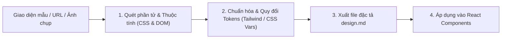

# design-md-chrome Skill (Trích Xuất & Tái Cấu Trúc Đặc Tả Thiết Kế Web)

Kỹ năng này đóng vai trò như một "máy quét thiết kế", giúp bóc tách toàn bộ mã gen (DNA) thẩm mỹ của một website mẫu và chuẩn hóa thành file tài liệu `design.md`. Từ đó, đội ngũ Dev có thể cover và tái hiện phong cách đó với độ chính xác tuyệt đối mà không cần phỏng đoán.

## 1. Quy Trình Trích Xuất 4 Bước (Extraction Pipeline)



### Bước 1: Quét và Bóc tách Thuộc tính (Inspection)
- **Màu sắc thực tế (Computed Colors)**:
  - Nền trang chủ (`background-color`), Nền thẻ card, Viền (`border-color`).
  - Màu chữ tiêu đề (H1, H2), màu chữ mô tả, màu chữ ghi chú mờ.
  - Màu thương hiệu (Brand / Primary), Màu phụ (Secondary / Muted).
- **Typography & Font metrics**:
  - Tên Font (`font-family`), Kích thước (`font-size`), Chiều cao dòng (`line-height`), Độ đậm (`font-weight`), Khoảng cách chữ (`letter-spacing`).
- **Khoảng cách & Bố cục (Layout Geometry)**:
  - Chiều rộng tối đa của Container (`max-width`: ví dụ 1200px hay 1440px).
  - Khoảng cách giữa các Section (`margin-bottom` / `padding-y`).
  - Bo góc (`border-radius`: ví dụ 8px, 12px, hay 16px).
  - Đổ bóng (`box-shadow`).

### Bước 2: Chuẩn hóa thành File Đặc Tả `design.md`

Khi quét xong, tổng hợp thành tài liệu `design.md` theo cấu trúc chuẩn:

```markdown
# Design System Specification (Trích xuất từ Web Mẫu)

## 1. Color Palette (Bảng màu)
- Background Primary: `#FAF8F5` (Tailwind: `bg-stone-50` pha ấm)
- Background Card: `#FFFFFF` (`bg-white`)
- Border Subtle: `#E7E5E4` (`border-stone-200`)
- Text Heading: `#1C1917` (`text-stone-900`)
- Text Body: `#44403C` (`text-stone-700`)
- Text Muted: `#78716C` (`text-stone-500`)
- Brand Accent: `#8B2500` (Đỏ son truyền thống)
- Secondary Accent: `#D4AF37` (Vàng kim vinh danh)

## 2. Typography Hierarchy
- Display / H1: `font-serif font-bold text-3xl sm:text-4xl leading-tight tracking-tight`
- H2 Section Title: `font-serif font-semibold text-2xl sm:text-3xl text-stone-900`
- H3 Card Title: `font-sans font-semibold text-lg text-stone-800`
- Body Text: `font-sans font-normal text-base text-stone-700 leading-relaxed`
- Caption / Meta: `font-sans font-medium text-xs text-stone-500`

## 3. Shadows & Elevation
- Card Rest: `shadow-sm border border-stone-200/80`
- Card Hover: `hover:-translate-y-0.5 hover:shadow-md transition-all duration-200`
- Modal: `shadow-2xl border border-stone-300`

## 4. Reusable Component Patterns
- Primary Button: `bg-red-900 hover:bg-red-950 text-white font-medium px-4 py-2 rounded-lg shadow-sm active:scale-95 transition-all`
- Secondary Outline: `border border-stone-300 hover:bg-stone-100 text-stone-800 font-medium px-4 py-2 rounded-lg transition-all`
- Badge / Tag: `inline-flex items-center px-2.5 py-0.5 rounded-md text-xs font-medium bg-amber-50 text-amber-800 border border-amber-200/60`
```

## 2. Ứng Dụng để "Cover" Giao Diện Nhanh

Khi người dùng yêu cầu: *"Cover lại giao diện trang chủ của web X hoặc template Y"*:
1. Kích hoạt `design-md-chrome` để lập tức phân tích và tạo file `design.md`.
2. Kích hoạt `hallmark` để phối hợp bố cục tương ứng và bản địa hóa nội dung văn hóa dòng họ.
3. Kích hoạt `skills-for-design-engineers` để bổ sung bóng đổ đa tầng và chuyển động mượt mà.
4. Chuyển giao bộ token và component spec cho `fe-agent` lập trình thành mã nguồn React/Tailwind.
