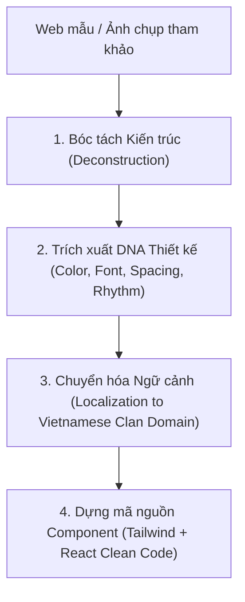

# Hallmark Skill (Đa Dạng Hóa Bố Cục & Phân Tích Tái Thiết Kế Web)

Kỹ năng Hallmark giúp Agent thoát khỏi cái bẫy "bố cục lười biếng" của AI (nơi mọi trang web đều có chung một cấu trúc: Hero trung tâm -> Lưới 3 card bằng nhau -> Bảng giá -> FAQ). Hallmark cung cấp phương pháp luận phân tích giao diện tham khảo và kiến tạo các bố cục đa dạng, độc đáo.

## 1. Phá Vỡ Bố Cục Dập Khuôn (Breaking the "AI Slop" Grid)

AI thông thường luôn có xu hướng chia trang thành lưới 3 cột đều chằn chặn. Hallmark định hướng các mô thức bố cục đột phá:

### A. Bento Grid có Điểm Nhấn (Asymmetric Bento Grid)
- Không chia đều mọi ô bằng nhau. Sử dụng tỷ lệ `col-span-2` cho thành phần trọng tâm (ví dụ: Thành tựu nổi bật của Thủy tổ hoặc Tin Đại lễ Giỗ Tổ năm nay), kết hợp các ô nhỏ `col-span-1` cho số liệu phụ (Số nhân khẩu, Số đời, Tồn quỹ).
- Tạo luồng quét mắt tự nhiên (F-pattern hoặc Z-pattern) dẫn dắt người xem từ điểm nhấn chính sang chi tiết phụ.

### B. Bố cục Chia Đôi Bất Đối Xứng (60/40 Split Screen)
- 60% bên trái: Lời răn tộc ước, trích đoạn phả ký với font Serif hoa mỹ, nền giấy dó cổ kính.
- 40% bên phải: Khung ảnh Từ đường sắc nét có lớp phủ màu phim ấm, tạo chiều sâu thị giác.

### C. Bố cục Dòng Thời Gian Xếp So Le (Alternating Timeline Layout)
- Ứng dụng cho trang Lịch Sử & Các Đời Phả Hệ: Thay vì danh sách đơn điệu, sử dụng trục thời gian dọc với các mốc lịch sử so le trái - phải, có chỉ số năm nổi bật và đường nối timeline trang nhã.

## 2. Quy trình Phân Tích & Cover Giao Diện Tham Khảo (Reference Site Analysis)

Khi người dùng cung cấp một trang web mẫu hoặc ảnh chụp màn hình cần "cover":

### Các bước phân tích chuẩn:
1. **Bóc tách Tỷ lệ & Khoảng cách (Spatial Rhythm)**:
   - Đo lường độ rộng container tối đa (`max-w-7xl` hay `max-w-5xl`).
   - Xác định khoảng cách giữa các khối (`py-16`, `py-24` hay `py-32`).
2. **Nhận diện Bảng màu (Color Extraction)**:
   - Màu chủ đạo (Dominant), Màu tương phản (Secondary), Màu nền ấm/lạnh, Màu viền (`border`).
3. **Cấu trúc Typography**:
   - Phân loại font Heading vs font Body, tỷ lệ phân cấp (`text-4xl font-bold` vs `text-lg text-stone-600`).
4. **Bản địa hóa & Tái tạo (Contextual Adaptation)**:
   - Không sao chép máy móc nội dung tiếng Anh hoặc phong cách SaaS công nghiệp.
   - Thay thế toàn bộ hình ảnh, biểu tượng và văn bản bằng tinh thần Dòng họ Nguyễn Bá: Bảng vàng công đức, Chân dung tiền hiền, Lễ hội giỗ tổ, Trúc mây phong thủy.
