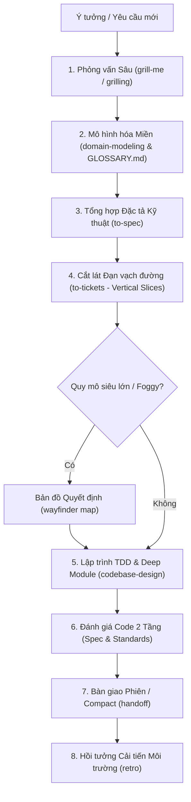

# Matt Pocock Engineering Framework (`mattpocock/skills`)

Bộ kỹ năng kỹ nghệ phần mềm chuyên sâu được phát triển bởi **Matt Pocock** (tác giả Total TypeScript), chuẩn hóa cho các AI Coding Agent nhằm triệt tiêu triệt để bệnh "vội vàng sinh code bừa bãi" (eager/rushed coding), chống thoái hóa cửa sổ ngữ cảnh (context window degradation), và kiến tạo phần mềm theo chuẩn mực công nghệ hàng đầu thế giới.

---

## 1. Triết lý Kỹ nghệ Cốt lõi (The Pocock Philosophy)

1. **Phỏng vấn triệt để trước khi viết Spec (Grill Before You Spec)**:
   - Tuyệt đối không phỏng đoán hay tự biên tự diễn yêu cầu của người dùng.
   - Sử dụng cây quyết định (**Design Tree**) với các vòng phỏng vấn (**Rounds**) để gỡ bỏ mọi sương mù nghiệp vụ.
2. **Định hình Miền & Thuật ngữ Nhất quán (Domain Modeling & Ubiquitous Language)**:
   - Mọi thực thể nghiệp vụ dòng họ (Đời, Chi, Phái, Tộc Trưởng, Trưởng Chi, Sổ Quỹ, Hương Hỏa...) phải được chuẩn hóa tại `GLOSSARY.md` và các quyết định kiến trúc tại `docs/adr/`.
   - Ngôn ngữ mập mờ, chồng chéo ngữ nghĩa phải bị chất vấn và làm rõ ngay lập tức.
3. **Đặc tả trước khi Lập trình (To-Spec)**:
   - Chuyển hóa toàn bộ kết quả phỏng vấn thành tài liệu đặc tả chuẩn mực (`Problem Statement`, `Solution`, `User Stories` chi tiết, `Implementation Decisions`, `Testing Decisions`, `Out of Scope`).
   - Xác định rõ các điểm nối kiểm thử (**Seams**) ở tầng cao nhất trước khi viết code.
4. **Cắt lát xuyên suốt dạng Đạn vạch đường (Tracer-Bullet Slicing - To-Tickets)**:
   - Chia nhỏ tính năng thành các lát cắt thẳng đứng (**Vertical Slices**) đi xuyên qua tất cả các tầng: Schema DB → API Endpoint → UI Component → Unit/E2E Test.
   - Mỗi ticket có phạm vi vừa vặn một cửa sổ ngữ cảnh duy nhất (1 context window).
   - Tuyên bố rõ các cạnh phụ thuộc (**Blocking Edges**) tạo thành đồ thị nhiệm vụ (Task DAG).
5. **Thiết kế Mô-đun Sâu (Deep Codebase Design)**:
   - Module sâu (**Deep Module**): Giao diện nhỏ gọn (Small Interface) che giấu bên trong khối xử lý mạnh mẽ, toàn diện (Deep Implementation).
   - Loại bỏ module nông (**Shallow Module**): Giao diện cồng kềnh nhưng bên trong chỉ là các lệnh chuyển tiếp đơn điệu.
   - Thử nghiệm phép xóa (**Deletion Test**): Xóa module đi có gom tụ sự phức tạp lại không?
6. **Bảo tồn Trí nhớ & Chuyển giao Phiên Sạch (Zero-Drift Handoff)**:
   - Khi phiên làm việc sắp đầy ngữ cảnh hoặc chuyển giao cho Sub-Agent khác, nén toàn bộ trạng thái vào tài liệu Handoff với danh sách kỹ năng đề xuất tiếp theo (`suggested skills`).
7. **Hồi tưởng & Tự động hóa Hàng rào Bảo vệ (Session Retro & Guardrails)**:
   - Sau mỗi chu kỳ làm việc, thực hiện Retrospective để chuyển hóa quy tắc văn bản thành hàng rào kiểm tra tự động (linter, typecheck, test suites) trên repo.

---

## 2. Bản đồ Quy trình Vòng đời Idea-to-Ship

---

## 3. Danh mục Bộ Kỹ năng Chi tiết

| Kỹ năng | Loại gọi | Mục đích chính | File đặc tả |
| :--- | :--- | :--- | :--- |
| **`grill-me`** / **`grilling`** | User / Model | Phỏng vấn dồn dập người dùng theo từng vòng (Round), định dạng `❓ Q` & `➡️ Recommend` | `skills/productivity/grilling/SKILL.md` |
| **`domain-modeling`** | Model | Chuẩn hóa từ điển nghiệp vụ `GLOSSARY.md` và ghi nhận quyết định `docs/adr/` | `skills/engineering/domain-modeling/SKILL.md` |
| **`to-spec`** | User | Biến hội thoại thành bản Spec đầy đủ (User Stories, Decisions, Seams, Out of Scope) | `skills/engineering/to-spec/SKILL.md` |
| **`to-tickets`** | User | Cắt nhỏ spec thành các tracer-bullet tickets dọc mọi tầng, khai báo `Blocked by` | `skills/engineering/to-tickets/SKILL.md` |
| **`wayfinder`** | User | Dẫn đường cho bài toán lớn nhiều sương mù qua bản đồ quyết định (Decision Tickets) | `skills/engineering/wayfinder/SKILL.md` |
| **`codebase-design`** | Model | Chuẩn hóa thiết kế Deep Module (Interface nhỏ, Implementation sâu, Seams, Adapters) | `skills/engineering/codebase-design/SKILL.md` |
| **`improve-codebase-architecture`** | User | Quét phát hiện module nông và tạo báo cáo trực quan kèm Mermaid/HTML để cải tiến | `skills/engineering/improve-codebase-architecture/SKILL.md` |
| **`handoff`** | User | Nén trạng thái phiên vào tài liệu handoff sạch, không mất mát ngữ cảnh | `skills/productivity/handoff/SKILL.md` |
| **`retro`** | User | Đánh giá phiên làm việc, đề xuất biến rule thành automated checks (CI/linter/test) | `skills/engineering/retro/SKILL.md` |

---

## 4. Phân công Trách nhiệm cho Đội ngũ 7 Sub-Agents

| Sub-Agent | Kỹ năng Pocock đảm nhiệm | Trách nhiệm cụ thể |
| :--- | :--- | :--- |
| **`pm-agent`** | `grill-me`, `to-spec`, `to-tickets`, `wayfinder`, `domain-modeling`, `handoff` | • Phỏng vấn người dùng làm rõ requirement. • Viết Spec chuẩn xác không giả định. • Phân bổ task graph tracer bullets. • Quản trị từ điển `GLOSSARY.md` và `docs/adr/`. |
| **`designer-agent`** | `grill-me`, `codebase-design`, `handoff` | • Phỏng vấn làm rõ trải nghiệm người dùng, vi tương tác. • Thiết kế giao diện component tinh gọn API, giàu tính năng nội tại. |
| **`be-agent`** | `codebase-design`, `domain-modeling`, `to-tickets`, `handoff` | • Xây dựng Deep Module cho Business Service & Repository. • Đảm bảo thuật ngữ code chuẩn 100% theo `GLOSSARY.md`. • Lập trình từng ticket đạn vạch đường (DB + API). |
| **`fe-agent`** | `codebase-design`, `domain-modeling`, `to-tickets`, `handoff` | • Xây dựng UI hooks & components có interface tối giản. • Hoàn thiện trọn vẹn lát cắt dọc kết nối API tới UI người dùng. |
| **`tester-agent`** | `codebase-design` (Seams), `to-tickets` | • Thiết kế test suite tại các điểm nối cao nhất (Highest Seams). • Kiểm thử nghiệm thu từng lát cắt dọc đạn vạch đường. |
| **`qa-agent`** | `retro`, `codebase-design` (Review), `handoff` | • Review code theo 2 trục: Chuẩn coding & Tuân thủ Spec. • Tổ chức Retro sau mỗi phiên để nâng cấp automated guardrails. |
| **`devops-agent`** | `handoff`, `retro` | • Cấu hình CI/CD chạy toàn bộ automated checks. • Bàn giao môi trường và báo cáo hạ tầng chuẩn xác. |
