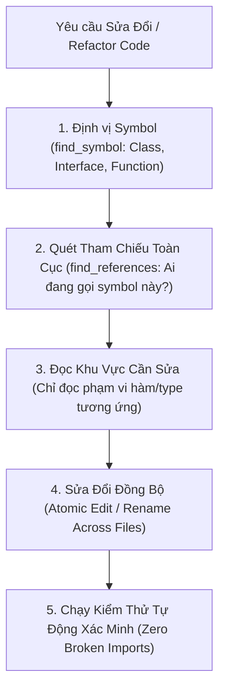

# Serena LSP Engine Skill (Điều Hướng & Tái Cấu Trúc Mã Nguồn Ngữ Nghĩa)

Được đúc kết từ kiến trúc của **`oraios/serena`** (hơn 31.000 sao trên GitHub), bộ kỹ năng này chuyển đổi phương thức làm việc của Agent từ "mò mẫm tìm kiếm chuỗi văn bản thuần túy" sang **hiểu sâu cấu trúc cây ngữ pháp (AST) và Language Server Protocol (LSP)** của TypeScript, Node.js và React.

## 1. Vấn Đề Lớn Của Coding Agent & Giải Pháp Từ Serena

- ❌ **Cách làm cũ (Context-Heavy & Shotgun)**:
  - Khi cần sửa một hàm, Agent đọc cả file hàng nghìn dòng vào ngữ cảnh, đốt hàng chục nghìn token vô ích.
  - Sửa đổi interface ở file A nhưng bỏ sót các import hoặc lời gọi ở file B, C, D, dẫn đến 5-7 lượt prompt sau đó chỉ để "vá víu" lỗi runtime.
- ✅ **Cách làm chuẩn Serena LSP**:
  - **Symbol-Level Precision**: Chỉ đọc đúng phạm vi thân hàm/class cần sửa.
  - **Global Reference Checking**: Truy vấn toàn bộ những nơi đang gọi hàm đó *trước khi* chạm vào code.
  - **Atomic Cross-File Rename**: Đổi tên biến/hàm/interface đồng bộ trên toàn bộ dự án trong 1 thao tác duy nhất.

## 2. Các Lệnh & Quy Trình Thao Tác Chuẩn Ngữ Nghĩa

### Quy tắc Thực Thi Dành Cho Developer Agents (`be-agent`, `fe-agent`, `qa-agent`):
1. **Trước khi sửa bất kỳ hàm/interface dùng chung**:
   - Quét tìm tất cả các nơi đang import và gọi hàm đó (`grep` tham chiếu hoặc LSP call hierarchy).
   - Lập danh sách các file chịu ảnh hưởng trước khi thực hiện chỉnh sửa.
2. **Không đọc thừa thãi**:
   - Nếu chỉ sửa logic tính ngày âm lịch trong hàm `convertSolarToLunar`, chỉ đọc block hàm đó và interface đầu vào/đầu ra, không đọc toàn bộ 800 dòng của module thiên văn học.
3. **Refactor Nguyên Tử (Atomic Refactoring)**:
   - Khi đổi tên trường dữ liệu trong SQLite Schema (ví dụ `isAlive` hoặc `deathLunarDate`), cập nhật đồng bộ từ:
     1. `server/src/db/database.ts` (Schema)
     2. `server/src/types/index.ts` (Backend Types)
     3. `server/src/services/*` (Service Logic)
     4. `client/src/types/index.ts` (Frontend Types)
     5. `client/src/components/*` (UI Render)
     6. `server/tests/suite.cjs` (Test Suite)
