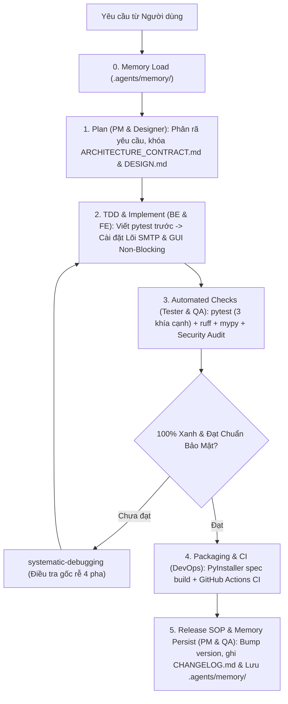

# Dev Team Structure & Responsibilities

Dự án **Ứng dụng Gửi Email Hàng Loạt Cho Nhà Cung Cấp (Gmail Auto Mailer)** được vận hành bởi đội ngũ **7 Sub-Agents chuyên trách**, kế thừa và tinh hoa từ hai dự án `Backup-data-to-NAS` và `Nguyen-Ba-Toc`, thống nhất cấu hình duy nhất tại `.agents/`:

| Vai trò | Sub-Agent ID | Đặc tả Rule & Agent | Trách nhiệm chính | Công cụ & Kỹ năng Thực thi |
| :--- | :--- | :--- | :--- | :--- |
| **PM (Project Manager)** | `pm-agent` | [rule](.agents/rules/pm-agent.md) • [agent](.agents/agents/pm-agent/agent.md) | Quản trị Trí nhớ Vĩnh cửu `.agents/memory/`, phân rã yêu cầu, khóa `docs/ARCHITECTURE_CONTRACT.md`, quản trị `GLOSSARY.md` & `CHANGELOG.md` | `agent-memory`, `brainstorming`, `grill-me`, `writing-plans`, `to-spec`, `to-tickets`, `handoff` |
| **UI/UX Designer** | `designer-agent` | [rule](.agents/rules/designer-agent.md) • [agent](.agents/agents/designer-agent/agent.md) | Định hình Design System **Modern Enterprise Precision** (`DESIGN.md`), WCAG 2.1 AA Dark/Light theme, Preview Dialog, Telemetry & Flow Control | `python-gui-architecture`, `impeccable-anti-slop`, `awesome-design-md`, `ui-ux-pro-max`, `frontend-design` |
| **Backend & Mail Core (BE)** | `be-agent` | [rule](.agents/rules/be-agent.md) • [agent](.agents/agents/be-agent/agent.md) | Xây dựng Lõi SMTP SSL Gmail, Pacing thông minh (1.5-3s chống spam), Exponential Backoff Retry, SQLite `history.db` chống khóa file | `gmail-smtp-engine`, `python-clean-testing`, `sqlite3`, `smtplib`, `ssl`, `email` |
| **Python GUI Dev (FE)** | `fe-agent` | [rule](.agents/rules/fe-agent.md) • [agent](.agents/agents/fe-agent/agent.md) | Phát triển giao diện Desktop Tkinter siêu nhẹ (**Non-Blocking UI Thread**), Background Worker (`queue.Queue`), điều khiển luồng (Pause/Resume/Cancel) | `python-gui-architecture`, `impeccable-anti-slop`, `skills-for-design-engineers`, `test-driven-development` |
| **Software Tester (Tester)** | `tester-agent` | [rule](.agents/rules/tester-agent.md) • [agent](.agents/agents/tester-agent/agent.md) | Kiểm thử tự động 3 khía cạnh (Happy Path, Edge Cases Unicode/file rỗng/đường dẫn dài, Chaos Network Drop/khóa file Excel) bằng `pytest` | **`pytest`**, `python-clean-testing`, `test-driven-development`, `systematic-debugging`, `verification-before-completion` |
| **Quality Assurance (QA)** | `qa-agent` | [rule](.agents/rules/qa-agent.md) • [agent](.agents/agents/qa-agent/agent.md) | Kiểm toán cam kết **Zero Plaintext Secrets** (keyring/AES-256) và **Zero Unverified Mail Loss**, kiểm tra tĩnh `ruff`, `mypy`, Release Gatekeeper | **`ruff`**, **`mypy`**, `requesting-code-review`, `ponytail-audit` |
| **DevOps & Packaging** | `devops-agent` | [rule](.agents/rules/devops-agent.md) • [agent](.agents/agents/devops-agent/agent.md) | Đóng gói thực thi độc lập `.exe` (`Gui_mail_nha_cung_cap.spec`), quản lý `pyproject.toml`, tự động hóa GitHub Actions CI/CD | `PyInstaller`, `pyproject.toml`, `.github/workflows/ci.yml` |

> Chi tiết quy trình phối hợp 6 giai đoạn: Xem **[`.agents/rules/team-workflow.md`](.agents/rules/team-workflow.md)**.

---

## ⚡ Chu Trình Phối Hợp Kỹ Nghệ 6 Giai Đoạn

